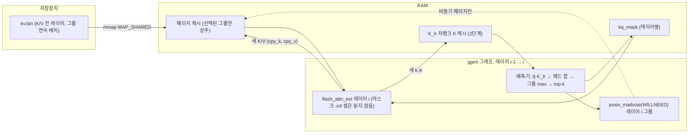

# KV cache 디스크 오프로딩 구현 계획서

작성일 2026-10-30 · 2026-11-03 Orange Pi 6 Plus 기준으로 수정 · PajamaParties (컴퓨터종합설계 2026-2) · 선행연구: KVSwap (MobiSys '26)

## 1. 목적과 범위

KVSwap의 핵심인 "전체 KV cache를 저장장치에 두고, 디코딩 때 중요한 KV 그룹만 골라 읽는다"를 팀의 llama.cpp CPU 빌드에 3단계로 구현한다. 1단계만 끝나도 연구 과제 2번(KV cache를 저장장치로 내렸을 때 병목이 메모리 대역폭에서 storage I/O로 옮겨가는지)을 측정할 수 있도록 단계를 나눈다.

**만드는 것**

- KV cache 버퍼를 저장장치 위의 파일로 옮기는 llama.cpp 패치 (1단계)
- 선택된 KV 셀만 읽도록 하는 어텐션 마스크 제어와 다음 레이어 프리페치 (1단계)
- 저랭크 K 캐시와 그룹 단위 top-k 예측기 (2단계)
- 명시적 디스크 I/O와 재사용 버퍼 (3단계, 시간이 남을 때)
- 각 단계의 처리량, 메모리, I/O, 품질 측정 스크립트

**만들지 않는 것**

- GPU 스테이징 버퍼와 CPU→GPU 복사 경로. 보드는 CPU 전용 빌드라 필요 없다.
- 논문의 오프라인 파라미터 튜너(30분 greedy 탐색). G, σ, M은 수동 스윕으로 정한다.
- RULER, LongBench 전체 품질 평가. 보드에서는 NIAH 축소판으로 대체한다.
- NPU 경로. 오프로딩은 llama.cpp CPU 빌드 대상이다.
- Gemma 4 E2B 지원. SWA 레이어와 전역 레이어가 섞인 iswa 캐시라 구조가 복잡하다. 오프로딩 작업은 Qwen3-1.7B로 진행한다.

### 1-1. 중간보고서와의 대조

중간보고서(파자마파티즈_중간보고서.pdf)와 맞춰 이 계획서에서 바꾼 것은 다음과 같다.

| 항목 | 중간보고서 | 이전 계획서 | 조치 |
|---|---|---|---|
| 메모리 주파수 | DMC disabled, 고정 | 7-4에서 메모리 주파수 2~3단계를 스윕 | 제거. CPU 주파수만 스윕 |
| RAM | 32 GB | 소용량 보드로 가정한 표현 | 32 GB 기준. 직접 I/O 모드(기본)는 메모리 제한 없이 오프로딩을 강제하고, cgroup 제한은 mmap 모드용 (6-1, 7-2) |
| 구현 범위 | "KVSwap의 일부를 단순화", 우선 KV 버퍼 mmap | 1~3단계 전체 | 1단계 필수, 2단계 조건부, 3단계 제외 (8절) |
| 일정 | 13주 간트 (KV 구현 6~8주, 오프로딩 스윕 9~10주) | 11/2 시작 날짜 간트 | 날짜 근거가 없어 제거하고 주차 기준으로 교체 |
| 역할 | 서예현 구현, 임예랑 분석 스크립트와 RI | 임예랑에 SVD 등 구현 일부 배정 | 보고서 분담으로 복원 |
| 모델 | Gemma 4 E2B(초기 스윕), Qwen3-1.7B(비교 기준) | Qwen3-1.7B | 일치 |
| 커널 | 5.10.198 | cgroup v2 가정 | 현재 보드는 6.6.89-cix, cgroup v2 |
| 플랫폼 | RK3588S | RK3588S | Orange Pi 6 Plus로 변경 (2절). 중간보고서와 달라지는 부분은 이 문서를 따른다 |

## 2. 기반 환경

README에 적힌 기준 커밋을 그대로 쓴다. 플래시 어텐션은 반드시 켜야 하므로 모든 실험에서 `-fa on`을 명시한다.

| 항목 | 내용 |
|---|---|
| 보드 | Orange Pi 6 Plus (CIX P1, Cortex-A720 ×8 + A520 ×4). 값의 출처는 board-results-2026-11-03.md |
| llama.cpp | b11278, 커밋 `931351ea5` (2026-09-30), CPU 전용 빌드 |
| 모델 | Qwen3-1.7B Q4_K_M (`unsloth/Qwen3-1.7B-GGUF`), 28 layers, GQA 16 Q heads / 8 KV heads, head_dim 128 |
| KV 형식 | F16 (기본값). 토큰당 레이어당 K 2 KiB + V 2 KiB, 토큰당 전체 112 KiB |
| 32K 컨텍스트 KV 크기 | 약 3.5 GiB (배치 1) |
| RAM | 31.7 GB, swap 없음. 32K 컨텍스트 KV 3.5 GiB가 통째로 페이지 캐시에 남을 수 있다. 직접 I/O 모드는 이를 막고, mmap 모드는 cgroup 메모리 제한이 필요하다 |
| 저장장치 | microSD `sda` 119 GiB, USB 2.0 컨트롤러(Genesys `05e3:0761`, 480 Mbps) 경유, ext4 (`/`와 같은 파일시스템). eMMC 없음. 제조사 사양상 M.2 NVMe 슬롯 2개(PCIe 4.0 x4)가 있으나 2026-11-06에 NVMe SSD(ADATA Swordfish 500 GB, PCIe 8 GT/s x4)를 달아 `/mnt/ssd`(`nvme0n1`, ext4)에 마운트했다. KV 파일은 `KV_FILE=/mnt/ssd/kv.bin DEV=nvme0n1`로 이 SSD에 둔다. fio 랜덤 읽기 한계가 약 1,500 IOPS, 약 32 MiB/s이고 큐 깊이를 올려도 늘지 않는다. 논문의 eMMC 약 250 MB/s의 약 1/8이라 KV 저장 위치로 부적합하다. 다른 장치 확보 여부는 팀이 정한다 |
| 커널 | 6.6.89-cix (벤더 BSP). cgroup v2, `memory` 컨트롤러 있음. `memory.max` 1.5G 제한으로 페이지 캐시 축출 확인 |
| 메모리 주파수 | 직접 조절할 인터페이스가 없다. 주파수 변수는 CPU(A720, A520)만 쓴다 |
| 커널 기능 | 직접 I/O 모드: `O_DIRECT`, `madvise(MADV_DONTNEED)`. mmap 모드: mmap, posix_madvise, cgroup memory 제한. io_uring은 쓰지 않는다(스레드 풀 pread) |
| 빌드/실행 | `cmake -B build -DGGML_NATIVE=OFF -DGGML_CPU_ARM_ARCH=armv9.2-a+i8mm+bf16+dotprod+fp16` (`NATIVE=ON`은 baseline armv8로 빌드됨), `taskset -c 6-11`, `-t 6`, `-fa on`, `-c 32768` |
| 소스 관리 | llama.cpp는 저장소에 넣지 않고 기준 커밋 대비 패치 파일(`patches/0N-*.patch`)로 관리 |

수정할 llama.cpp 파일과 역할은 다음과 같다. 행 번호는 기준 커밋 기준이다.

| 파일 | 현재 역할 | 수정 단계 |
|---|---|---|
| `src/llama-kv-cache.cpp` (205~295행) | KV 텐서 생성, CPU buft로 버퍼 할당, memset 0 | 1 |
| `src/llama-kv-cache.cpp` (1541~1782행) | kq_mask 생성 (`set_input_kq_mask`) | 1 |
| `src/llama-mmap.cpp` | 파일 mmap과 posix_madvise 헬퍼 | 1 (재사용) |
| `ggml/src/ggml-cpu/ops.cpp` (8744, 9009행) | FA 커널이 마스크 -inf 셀을 K/V 읽기 전에 건너뜀 | 수정 없음, 확인만 |
| `src/llama-graph.cpp` (3022~3084행) | DeepSeek V3.2용 top-k 인덱스 → kq_mask 언마스크 | 2 (재사용) |
| `src/models/qwen3.cpp` (110행 부근) | Qwen3 어텐션 그래프 | 2 |
| `src/llama-context.cpp` (1423행) | `ggml_backend_sched_set_eval_callback` 등록 | 1, 2 |
| `ggml/include/ggml.h` | `ggml_pool_1d`, `ggml_top_k`, `ggml_set_rows`, `ggml_custom_4d` | 2, 3 (재사용) |

## 3. 설계 개요

llama.cpp에는 KVSwap에 필요한 부품의 절반 이상이 이미 있다. 새로 짜야 하는 것은 mmap 버퍼 교체, 저랭크 K 캐시, 그리고 두 틈을 잇는 예측 그래프다.

| KVSwap 구성요소 | llama.cpp 현황 | 작업 | 단계 |
|---|---|---|---|
| (a) 전체 KV를 디스크에 | KV 버퍼는 CPU buft로 malloc. `ggml_backend_cpu_buffer_from_ptr`로 임의 포인터를 버퍼로 감쌀 수 있고, 모델 로더가 같은 방식으로 mmap 가중치를 쓴다 | 파일 mmap 포인터로 교체 | 1 |
| 선택된 셀만 읽기 | CPU 플래시 어텐션 커널이 마스크 -inf 셀을 K/V 접근 전에 건너뛴다. 비FA 경로는 K 전체를 mul_mat하므로 불가 | 없음 (FA 강제) | 1 |
| 그룹 단위 디스크 레이아웃 | K, V 모두 셀당 한 행(2 KiB)이 연속 배치. FA에서는 V도 전치하지 않음 | 없음. G를 페이지 크기에 맞춤 | 1 |
| (c) top-k → 마스크 | DeepSeek V3.2 희소 어텐션용으로 `ggml_set_rows`로 kq_mask를 푸는 코드가 있다 | 복사해 일반 KV 캐시에 연결 | 2 |
| (b) 저랭크 K 캐시 | 없음 | 레이어별 `K_lr[r, kv_size]` 텐서 추가, K 저장 시 `mul_mat(A, k)` + `set_rows` | 2 |
| 저랭크 어댑터 A | 없음 | 파이썬으로 C4 샘플 K 캐시를 모아 SVD, GGUF 사이드 파일로 로드 | 2 |
| 그룹 ReduceMax, TopK | `ggml_pool_1d`(max), `ggml_top_k`, `ggml_argsort_top_k` | 없음 | 2 |
| 레이어 i-1 중 레이어 i 프리페치 | `ggml_backend_sched_set_eval_callback`(노드마다 호출) 또는 `ggml_custom_4d` 커스텀 노드 | 콜백에서 `posix_madvise(WILLNEED)` | 1, 2 |
| (e) 재사용 버퍼, 롤링 버퍼 | 없음. 1단계에서는 OS 페이지 캐시가 재사용 버퍼, 마스크의 최근 창이 롤링 버퍼 역할 | 3단계에서 compact 버퍼로 구현 | 3 |

디코드 한 스텝의 데이터 흐름은 다음과 같다. 단계별로 어텐션이 K/V를 어디서 읽는지만 달라지고 그래프의 나머지는 그대로다.



## 4. 1단계: mmap KV 버퍼 + 마스크 선택

어텐션 경로는 손대지 않고 KV 버퍼의 뒷배기만 파일로 바꾼다. 예측기 없이 "최근 W개 + 고정 선택 집합"만 풀어도 I/O 경로가 완성되므로, 이 단계만으로 연구 과제 2번을 측정할 수 있다.

### 4-1. KV 버퍼를 파일 mmap으로 교체 (`llama-kv-cache.cpp` 생성자)

1. 새 컨텍스트 파라미터 `kv_offload_path`를 추가하고, CLI에 `--kv-offload-path <file>`을 붙인다.
2. 경로가 있으면 `ggml_backend_alloc_ctx_tensors_from_buft` 대신 다음 순서로 할당한다.
   1. 필요 크기를 `ggml_backend_alloc_ctx_tensors_from_buft_size`로 구한다.
   2. 파일을 `ftruncate`로 그 크기로 만든다 (sparse 파일).
   3. `MAP_SHARED`로 mmap한다. `llama-mmap.cpp`의 `llama_mmap` 클래스를 재사용한다.
   4. `ggml_backend_cpu_buffer_from_ptr(addr, size)`로 버퍼를 만든다.
   5. `ggml_tallocr`로 각 텐서를 그 버퍼 안에 배치한다.
3. `ggml_backend_buffer_clear`(memset 0)는 건너뛴다. sparse 파일은 어차피 0으로 읽히고, memset을 하면 3.5 GiB가 더티 페이지가 된다.
4. 전체 범위에 `posix_madvise(POSIX_MADV_RANDOM)`을 걸어 커널 readahead를 끈다. 그룹 단위 읽기는 우리가 직접 제어한다.
5. 소멸자에서 `munmap`한다. 파일은 다음 실행을 위해 남기거나 `--kv-offload-unlink`로 삭제한다.

**완료 기준.** `llama-cli -c 32768`로 32K 프롬프트를 넣었을 때 출력이 기준 빌드와 토큰 단위로 같다. `/proc/<pid>/status`의 RssAnon이 기준 대비 KV 크기만큼 줄고 RssFile이 그만큼 늘어난다.

### 4-2. 마스크로 선택 읽기 (`set_input_kq_mask`)

1. 디코딩 배치(n_tokens가 작은 경우)에서만 적용한다. 프리필은 기존 causal 마스크 그대로 둔다.
2. 셀 c에 대해 다음 중 하나면 0, 아니면 -inf로 둔다.
   - `pos ≥ cur_pos - W`인 최근 창 (롤링 버퍼 역할, W = 256 시작)
   - 선택 집합 `selected[il]`에 들어 있는 그룹의 셀
3. 레이어별 선택 집합이 필요하므로 마스크 텐서를 레이어별로 분리한다. 현재는 모든 레이어가 한 마스크를 공유하므로 `build_attn_inp_kv`에서 `[n_kv, n_tokens, 1, n_layer]`로 늘리거나 레이어별 입력 텐서를 만든다. F16 기준 32K × 28 레이어 = 1.8 MiB라 부담은 없다.
4. 1단계의 선택 집합은 예측 없이 고정 규칙으로 만든다: 처음 4 그룹(attention sink) + 전체에서 균등 간격으로 M개 그룹. 품질은 나쁘지만 I/O 양이 논문과 같아 처리량과 병목 측정에는 충분하다.
5. 그룹 크기 G는 페이지 크기에 맞춘다. Qwen3-1.7B는 K 한 셀이 2 KiB라 4 KiB 페이지에 2셀이 들어간다. G ∈ {2, 4, 8, 16}을 스윕한다.

**완료 기준.** 선택 집합을 "전체"로 두면 출력이 기준 빌드와 같다 (정확성 검증). 선택 집합을 M개 그룹으로 두면 `/proc/<pid>/stat`의 majflt가 디코드 토큰당 약 (선택 셀 수 × 2 × 28 / 페이지당 셀 수)에 근접한다. 전체 K/V를 읽고 있다면 이 값이 수십 배 크다.

### 4-3. 다음 레이어 프리페치 (`cb_eval`)

1. `llama_context_params.cb_eval`에 콜백을 등록한다. 콜백은 그래프의 노드마다 호출되므로 이름이 `kqv_out-<il>`인 노드가 끝났을 때 레이어 il+1의 선택 그룹 범위에 `posix_madvise(POSIX_MADV_WILLNEED)`를 건다.
2. 한 그룹은 K 영역과 V 영역 두 군데이므로 그룹당 madvise 2회. M = 100 그룹이면 레이어당 200회 시스템 콜이다. 비용이 보이면 인접 그룹을 병합해 호출 수를 줄인다.
3. 콜백이 있으면 스케줄러가 그래프를 노드 단위로 나눠 실행하므로 오버헤드가 생긴다. 콜백 없는 빌드와 있는 빌드의 처리량을 인메모리 설정에서 먼저 비교해 오버헤드를 기록해 둔다.

**완료 기준.** 프리페치 켜고 끌 때 디코드 TPOT 차이가 측정되고, `iostat -x 1`의 r/s가 프리페치 시 더 고르게 분포한다.

## 5. 2단계: 저랭크 K 캐시 기반 예측기

1단계의 고정 선택 집합을 논문의 예측기로 바꾼다. 선택 로직은 ggml 그래프 안에서 돌고, 선택 결과를 마스크로 바꾸는 부분은 DeepSeek V3.2 코드를 그대로 가져온다.

### 5-1. 오프라인 어댑터 A (파이썬, 노트북에서)

1. Qwen3-1.7B를 transformers로 읽고 C4 샘플 64개(각 2K 토큰)를 통과시켜 레이어별 K 캐시(RoPE 적용 후)를 모은다. 크기는 `[N, 8×128]`.
2. 레이어별 SVD로 상위 r개 우특이벡터를 어댑터 `A[1024, r]`로 저장한다. 논문의 압축비 σ = 1024/r이며 σ ∈ {8, 16, 32}, 즉 r ∈ {128, 64, 32}를 만든다.
3. 별도 GGUF 파일(`qwen3-1.7b-kvswap-adapter.gguf`)로 저장하고 `--kv-adapter <file>`로 로드한다. gguf-py로 쓰고 `gguf_init_from_file`로 읽으면 된다.

### 5-2. 압축 K 캐시 유지 (`llama-kv-cache.cpp`, `cpy_k`)

1. 레이어별로 RAM에 `K_lr[r, kv_size]` F16 텐서를 추가한다. σ = 8이면 32K 컨텍스트에서 레이어당 8 MiB, 전체 224 MiB.
2. `cpy_k`가 새 K를 캐시에 쓰는 자리에 `k_lr = mul_mat(A, k_cur)` → `set_rows(K_lr, k_lr, k_idxs)` 노드를 추가한다. 프리필과 디코드 모두 같은 경로를 타므로 추가 코드는 한 곳이다.

### 5-3. 예측 그래프 (`src/models/qwen3.cpp`)

레이어 i-1의 어텐션 입력 `x_{i-1}`을 가지고 레이어 i의 중요 그룹을 고른다. 다음 노드들을 레이어 i-1의 FFN 앞에 끼워 넣는다.

1. `q_tilde = rope(norm(x_{i-1}) · Wq_i)`: 레이어 i의 가중치로 근사 Q. `[128, 16, n_tokens]`.
2. `q_lr = mul_mat(A_i, q_tilde)`: 낮은 차원으로 투영. `[r, 16, n_tokens]`.
3. `scores = mul_mat(K_lr_i, q_lr)`: 저랭크 어텐션 점수. `[n_kv, 16, n_tokens]`.
4. 헤드 합: `[16, n_kv]`로 permute 후 `ggml_sum_rows`. `[n_kv, n_tokens]`.
5. `group = ggml_pool_1d(scores, GGML_OP_POOL_MAX, G, G, 0)`: 그룹 ReduceMax. `[n_kv/G, n_tokens]`.
6. `top = ggml_top_k(group, M)`: 그룹 인덱스 `[M, n_tokens]`.
7. 그룹 인덱스를 셀 인덱스로 펼친다: `top*G + [0..G-1]`. ggml에 정수 브로드캐스트 덧셈이 마땅치 않으므로 `ggml_custom_4d` 커스텀 노드 하나로 처리한다. 이 노드가 동시에 레이어 i의 `posix_madvise(WILLNEED)`를 걸어 4-3의 콜백을 대체한다.
8. `llama-graph.cpp` 3022~3084행의 방식대로 `ggml_fill(-inf)` + `ggml_set_rows(0)`으로 레이어 i의 마스크를 만들고 기존 causal 마스크와 더한다. 최근 W 셀은 항상 0으로 둔다.

논문 규칙대로 레이어 0, 1은 정확한 입력을 쓰고(예측 없이 전체 읽기, 또는 자기 입력으로 예측), 레이어 2부터 이전 레이어 입력을 쓴다. 프리필 배치에서는 예측 그래프를 빌드하지 않는다.

**기본 파라미터** (논문 Sec. 6.1 기준, 수동 스윕으로 조정)

| 파라미터 | 기본값 | 스윕 범위 |
|---|---|---|
| 그룹 크기 G | 8 (논문의 eMMC 기준) | 2, 4, 8, 16 |
| 선택 셀 수 M×G | 400 | 200, 400, 800 |
| 압축비 σ | 8 | 8, 16, 32 |
| 최근 창 W | 256 | 64, 256 |

**완료 기준.** NIAH 축소판(4K~32K, 깊이 5단계, 25문항)에서 예측기 버전이 1단계의 고정 선택보다 높고 Full-KV 대비 정확도 손실 10% 이내. 논문의 KVSwap-t(eMMC)는 LongBench에서 2.7% 손실이었다.

## 6. 1b단계(구현됨)와 3단계(선택): 명시적 I/O

### 6-1. 1b단계: 직접 I/O 모드 (구현 완료, 패치 02)

1단계 mmap 방식은 OS 페이지 캐시가 KV를 RAM에 남겨 두면 오프로딩이 일어나지 않아서 cgroup 메모리 제한이 있어야 의미가 있었다. "메모리 제한이 없어도 항상 오프로딩되어야 한다"는 요구에 맞춰, 페이지 캐시에 의존하지 않고 RAM 상주를 우리가 직접 통제하는 모드를 추가했다. 켜는 방법은 `LLAMA_KV_IO=direct`다.

- **구조.** KV 텐서는 익명 메모리(스테이징 영역)에 두고, 파일은 같은 배치의 유일한 완전한 사본이다. 파일 오프셋은 스테이징 영역 안의 오프셋과 같다. 모든 텐서는 페이지 경계에 맞춰 배치한다.
- **쓰기.** G개 셀이 채워진 그룹은 `O_DIRECT` `pwrite`로 파일에 쓴다. 최근 창(W) 안의 그룹은 RAM에 남긴다. 창 시작은 그룹 경계로 내림한다.
- **읽기.** 디코드 스텝마다 창 밖에서 선택된 그룹만 `O_DIRECT` `pread`로 읽는다. 읽기는 리더 스레드 풀이 비동기로 수행하고, 레이어 i 어텐션 직전(`kvswap_wait-i` 노드)에 완료를 기다린다. 읽은 데이터는 원래 주소에 그대로 들어가므로 수정하지 않은 flash-attention 커널이 1단계 마스크로 그대로 동작한다.
- **해제.** 어텐션이 끝나면(`kqv_out-i` 노드) 읽은 페이지를 `MADV_DONTNEED`로 돌려준다. 같은 시점에 레이어 i+1+DEPTH의 읽기를 발행한다(`LLAMA_KV_IO_DEPTH`, 기본 1).
- **RAM 상주량.** 창 + 읽는 중인 DEPTH+1개 레이어의 선택 분량. 컨텍스트 길이와 무관하다.
- **prefill.** 프롬프트 처리 중에는 전체 KV가 RAM에 있다가, 첫 디코드 스텝에서 창 밖 전체가 해제된다. 따라서 prefill 순간 최대 상주량은 전체 KV 크기(Qwen3-1.7B 32K에서 약 3.5 GiB)다. 디코드 단계만 오프로딩 대상이다. 32 GB 보드에서는 문제가 없다.
- **I/O 요청 단위.** 선택한 그룹 하나가 요청 하나(G×행 크기, 예: 16 KiB)다. 인접한 그룹은 합쳐서 요청한다. 요청 수가 많아 저장장치에서 지연이 클 수 있고, 이는 G를 키우는 이유가 된다.
- **제약.** 단일 시퀀스, `-fa on`, SWA/iSWA가 아닌 일반 어텐션 모델(Qwen3 등), 레이어 공유 없음. 그룹 바이트 수(`G × 행 크기`)가 페이지 크기의 배수여야 한다(Qwen3-1.7B: 행 2 KiB, 4 KiB 페이지에서 G ≥ 2). 맞지 않으면 시작 시 오류로 알려 준다. 컨텍스트 이동(shift)과 부분 시퀀스 삭제는 지원하지 않는다.
- **논문과 다른 점.** 읽기 발행에 io_uring 대신 스레드 풀 `pread`를 쓴다(구현을 단순하게 두기 위해서). 큐 깊이는 스레드 수로 정한다. 예측기와 재사용 버퍼가 없다. 이 둘이 2단계와 3단계다.
- **측정 시 해석.** RAM이 남아도 항상 디스크를 읽으므로 B1과 B2는 "오프로딩을 강제한 조건"의 값이다. 보고서에 그렇게 적는다. `kvswap_dio:` 로그 줄이 읽은 양, 쓴 양, 읽기 대기 시간, 마지막 상주량을 직접 알려 주므로 `iostat`과 교차 검증한다.

### 6-2. 3단계(선택): 재사용 버퍼와 compact 어텐션

1b단계 위에서 남은 차이를 메운다. 2단계까지 끝나고 시간이 남을 때만 진행하며, 논문과의 구조 일치가 목적이다. (1b단계가 3단계의 3~4번 항목 중 파일 I/O와 읽기/대기 분리를 이미 구현했다.)

1. 레이어별 compact 버퍼 `K_sel[n_embd, M×G + W]`, `V_sel` 을 RAM에 둔다. `get_k`/`get_v`가 전체 캐시 뷰 대신 이 버퍼를 돌려준다. 어텐션의 n_kv가 M×G + W로 고정되어 마스크는 causal만 남는다.
2. 슬롯 테이블(그룹 ID → 슬롯)을 두고 예측 결과와 비교해 이미 있는 그룹은 두고 없는 그룹만 `pread`(또는 io_uring)로 읽어 빈 슬롯에 넣는다. 교체는 논문처럼 FIFO.
3. 새 K/V는 롤링 버퍼에 쌓다가 G개가 차면 파일에 `pwrite`한다. 파일 I/O는 `O_DIRECT`로 열어 페이지 캐시를 우회하면 메모리 사용량을 정확히 통제할 수 있다.
4. 읽기 요청 발행은 레이어 i-1의 커스텀 노드에서, 완료 대기는 레이어 i 어텐션 직전의 커스텀 노드에서 한다.

**완료 기준.** 같은 G, M에서 1b단계 대비 TPOT이 같거나 낮고, RSS가 K_lr + compact 버퍼 + 모델 가중치 수준으로 일정하다.

**2026-11-08 진행.** 2번(재사용 버퍼)만 [패치 05](../../code/patches/05-kv-reuse-buffer.patch)로 구현했다. compact 버퍼 없이 데이터를 원래 주소에 두고 마스크를 그대로 쓰며, 교체는 FIFO 대신 LRU다. NVMe 8K에서 출력은 그대로이고 TPOT이 176 ms에서 72 ms(`LLAMA_KV_REUSE=200`)로 줄었다. 1번 compact 어텐션은 하지 않는다. 결과는 [kvswap-reuse.md](kvswap-reuse.md).

## 7. 측정 계획

핵심 질문은 "KV를 저장장치로 내리면 지배 자원이 메모리에서 storage로 바뀌는가"이다. 따라서 같은 주파수 스윕을 인메모리 설정과 오프로딩 설정에서 반복하고 민감도를 비교한다.

### 7-1. 비교 설정

| 이름 | KV 위치 | 선택 | 대응되는 논문 baseline |
|---|---|---|---|
| B0 | RAM (기준 빌드) | 전체 | vLLM / Full-KV |
| B1 | 저장장치 직접 I/O (기본) 또는 mmap | 전체 (마스크 없음) | FlexGen |
| B2 | 저장장치 직접 I/O (기본) 또는 mmap | 고정 M 그룹 + 최근 W (1단계) | 없음, I/O 양만 같음 |
| B3 | 저장장치 직접 I/O | 예측기 (2단계) | KVSwap |
| B4 | 저장장치 직접 I/O | 예측기 + 재사용 버퍼 (3단계) | KVSwap |

`scripts/kvswap/run_stage1.sh`는 `KV_IO=direct`(기본)로 B1, B2를 직접 I/O로 돌린다. `KV_IO=mmap`이면 1단계 방식이고 아래 7-2의 메모리 제한이 필요하다.

### 7-2. 메모리 압박 만들기 (mmap 모드에서만 필요)

직접 I/O 모드(기본)는 메모리 제한 없이 항상 디스크를 읽으므로 이 절의 cgroup이 필요 없다. `MEM_MAX`를 비워 두면 된다. 아래는 `KV_IO=mmap`으로 1단계 방식을 비교할 때의 절차다. 보드 RAM이 32 GB라 KV 파일 3.5 GiB가 전부 페이지 캐시에 남고 디스크 I/O가 0이 되므로 다음 두 가지를 반드시 한다.

- cgroup v2로 프로세스 메모리를 제한한다. 파일 페이지도 과금되므로 페이지 캐시가 제한 안에 갇힌다.
  ```sh
  sudo mkdir /sys/fs/cgroup/llm
  echo 2G | sudo tee /sys/fs/cgroup/llm/memory.max
  echo $$ | sudo tee /sys/fs/cgroup/llm/cgroup.procs
  taskset -c 6-11 ./llama-cli ... --kv-offload-path /data/kv.bin
  ```
  memory.max는 모델 가중치(약 1.1 GiB) + 작업 메모리 + 허용 KV 예산으로 정한다. 2 GiB, 1.5 GiB 두 수준을 쓴다.
- 매 측정 전 `sync; echo 3 > /proc/sys/vm/drop_caches`로 페이지 캐시를 비운다.

### 7-3. 지표

| 지표 | 도구 | 비고 |
|---|---|---|
| TPOT, TTFT (ms), decode tokens/s | llama-cli 타이밍 출력, 1000 토큰 생성 평균 | 논문과 같은 길이 |
| 메이저 페이지 폴트 수 | `/proc/<pid>/stat` majflt, `perf stat -e major-faults` | 선택 셀 수와 비교 |
| 디스크 읽기 r/s, rkB/s, await, %util | `iostat -x 1` | 병목 판정의 주 지표 |
| KV 읽은 양, 쓴 양, 읽기 대기 시간, 상주량 | 실행 로그의 `kvswap_dio:` 줄 (요약 CSV의 `kv_read_mb`, `kv_write_mb`, `io_stall_s`, `kv_resident_mb`) | 직접 I/O 모드 전용. `iostat`과 교차 검증 |
| CPU %iowait, %user | `mpstat -P 6-11 1` | iowait 상승 = storage 병목 |
| RSS (Anon/File) | `/proc/<pid>/status` | 메모리 예산 확인 |
| 전력 (W) | EM 또는 OPP 기반 추정 (측정 계획서 4절) | 보드 센서 없음, 외장 전력계 미사용 (팀 결정) |
| 온도 | `thermal_zone*/temp` | 스로틀링 확인. zone이 전부 `acpitz`라 매핑 전에는 최댓값을 쓴다 |
| 품질 | NIAH 축소판 정답률, 1단계 전체 선택 시 토큰 일치 | B3, B4만 |

### 7-4. 주파수 스윕

메모리 주파수는 조절할 수 없어 변수가 아니다. 측정 계획서 5-1절의 A720 주파수 집합(상한 2.2 GHz)을 인메모리(B0)와 오프로딩(B1, B2)에서 각각 수행하고, A520 코어 스윕도 같은 설정으로 반복한다. 다음을 본다.

- CPU 주파수를 내릴 때 decode t/s가 얼마나 떨어지는가. 오프로딩에서 덜 떨어지면 지배 자원이 storage로 옮겨간 것이다.
- 주파수 민감도의 knee 위치가 인메모리에서 오프로딩으로 바뀌는가. 이 보드의 knee는 아직 측정하지 않았다.
- 저장장치 쪽 지표(await, %util)가 포화에 가까운가.
- 토큰당 에너지(J/token)가 어느 조합에서 최소인가. 전력은 추정값이므로 CPU 동적 전력만 들어가고 저장장치 전력은 빠진다.

이 보드에는 메모리 주파수를 직접 조절할 인터페이스가 없다. 따라서 "memory frequency가 오프로딩 환경에서 미치는 영향"은 직접 측정할 수 없다. 연구 배경에 적힌 이 부분은 저장장치 지표와 CPU 주파수 민감도로 간접 분석하거나, 한계로 명시해야 한다. 이는 팀이 정할 문제다.

논문 Fig. 2에 해당하는 현재 microSD의 fio 결과는 board-results-2026-11-03.md 2차 6절에 있다. KV 저장장치를 바꾸면 다시 측정한다.

## 8. 일정과 역할

일정은 중간보고서의 13주 계획을 따른다. 주차와 날짜의 대응은 보고서에 없어 날짜는 적지 않는다.

| 주차 (보고서) | 담당 | 이 계획의 작업 | 산출물 |
|---|---|---|---|
| 6~8 | 서예현 | 4절 1단계. 패치는 작성 완료. 보드에서 정확성 확인(`-fa on`, 파일 백킹 출력이 기준과 일치), 소규모 선행 실행으로 I/O 발생 확인 | 보드에서 동작하는 1단계 패치 |
| 6~8 | 임예랑 | 측정·요약 스크립트 정리(`run/sweep/summarize_stage1`), 분석 스크립트가 RI 산출 입력으로 쓸 CSV 형식 확정 | 스크립트와 CSV 스키마 |
| 8~9 | 김휘영, 김지호 | 인메모리 주파수 스윕 (B0 기준선) | B0 결과 |
| 9~10 | 서예현 | 오프로딩 스윕: `sweep_stage1.sh`(B1, B2, 프리페치, G, 선택량)와 fio 저장장치 특성 | B1, B2 결과, fio 곡선 |
| 9~10 | 김휘영 | 오프로딩 설정에서 CPU 주파수 스윕, 전력 추정 | 주파수별 t/s와 J/token |
| 10~11 | 임예랑 | RI 행렬 산출, 인메모리와 오프로딩 비교 | RI 행렬, 병목 이동 분석 |
| 11~13 | 전원 | 지배 자원 기반 제어 로직, 평가, 최종 정리 | 최종보고서 |

**범위 결정**

- **1단계는 필수다.** 연구 과제 2번(병목이 storage로 이동하는가)은 B1(전체 읽기)과 B2(선택 읽기)만으로 답할 수 있다.
- **2단계(예측기)는 조건부다.** 6~8주에 1단계 보드 검증이 끝나고, 9~10주 스윕과 겹치지 않을 때만 한다. 착수 기준은 다음과 같다.
  - B2가 정상 상태에서 storage 병목이 아니면(6~7절의 예상) 2단계 없이는 "선택 읽기에서의 병목 이동"을 보일 수 없다. 이때는 선택량을 늘려 재측정하는 쪽이 먼저고, 예측기는 그다음이다.
  - 2단계를 하면 5-1의 SVD 스크립트가 필요하다. 보고서 분담상 구현은 서예현, 분석 스크립트는 임예랑이므로 SVD는 담당을 팀이 정해야 한다.
- **3단계(재사용 버퍼, compact 어텐션)는 제외한다.** (2026-11-08: 연속 스텝 간 선택 겹침이 8K 실제 텍스트에서 0.64로 커서 재사용 버퍼만 패치 05로 구현했다. compact 어텐션은 계속 제외.) 보고서의 "단순화해 구현"과 맞지 않고 13주 안에 측정까지 끝내기 어렵다. 명시적 I/O 자체는 "메모리 제한 없이 항상 오프로딩" 요구 때문에 1b단계로 앞당겨 구현했다.

## 9. 리스크와 대응

| 리스크 | 영향 | 대응 |
|---|---|---|
| 페이지 캐시에 KV가 전부 남아 디스크 I/O가 발생하지 않음 (mmap 모드) | 측정 무효 | 직접 I/O 모드를 기본으로 사용. mmap 모드는 cgroup memory.max 필수, 매 측정 전 drop_caches, majflt로 I/O 발생 확인 |
| 보드 파일시스템이 `O_DIRECT`를 지원하지 않음 | 직접 I/O가 버퍼 I/O로 떨어짐 | 시작 로그의 `O_DIRECT`/`BUFFERED` 표시 확인. BUFFERED이면 fadvise로 캐시를 비우지만 의미가 약하므로 ext4 등 지원하는 파일시스템에 KV 파일을 둔다 |
| 4 KiB 정렬 요구로 G가 너무 작으면 시작 오류 | 실행 불가 | Qwen3-1.7B는 G ≥ 2. 로그의 오류 문구대로 G를 키운다 |
| eval callback의 노드 단위 실행 오버헤드가 큼 | 1단계 처리량 왜곡 | 인메모리에서 콜백 유무 차이를 먼저 측정. 크면 2단계처럼 `ggml_custom_4d` 노드로 교체 |
| MAP_SHARED 더티 페이지 writeback이 프리필 중 저장장치 쓰기 트래픽을 만듦 | TTFT 증가, 디코드 중 읽기와 경합 | mmap 모드는 패치 03이 첫 단일 토큰 디코드 직전에 `msync(MS_SYNC)`로 끝까지 기다린다. 이 시간은 프리필과 디코드 시간에 들어가지 않고 로그의 `flushed prefill writes` 줄에 남는다. 디코드 중 쓰기는 토큰당 112 KiB라 작음 |
| FA 커널의 KV 범위 스레드 분할이 희소 마스크에서 불균형 | 스레드 활용 저하 | 선택 그룹을 전체 범위에 고르게 두는지 확인. 심하면 chunk_size 조정 패치 |
| 비FA 경로가 켜지면 K 전체를 읽음 | 모든 셀 페이지인 | 모든 실행에 `-fa on`, 로그의 `flash_attn = enabled` 확인을 스크립트로 자동화 |
| 1단계 고정 선택의 생성 품질이 낮아 출력이 짧거나 반복됨 | 1000 토큰 생성이 안 됨 | 처리량 측정은 `--ignore-eos -n 1000`으로 강제 생성. 품질은 2단계에서만 평가 |
| 레이어별 마스크로 늘리면 그래프 입력이 바뀌어 기존 그래프 재사용 로직과 충돌 | 빌드 실패 또는 성능 저하 | 마스크는 입력 텐서라 값만 바뀌면 재사용 가능. 모양을 바꾸지 않고 `[n_kv, n_tokens, 1, n_layer]`로 고정 |
| 어댑터 A가 C4로 만든 것이라 다른 도메인에서 예측 품질이 떨어짐 | 2단계 품질 미달 | 논문 Sec. 5.6에서 교차 도메인 손실 0.8% 이내로 보고됨. 필요하면 NIAH 텍스트로 재프로파일 |
| 2단계가 늦어져 3단계와 분석이 밀림 | 최종보고 일정 | 3단계는 선택. 12/7에 2단계 완료 여부로 진행 결정, 미완이면 B2 결과로 분석 |
| 벤더 커널(6.6.89-cix)에서 posix_madvise 동작이 다름 | 프리페치 측정 왜곡 | `PREFETCH=0`/`1` 비교와 madvise 테스트 프로그램으로 확인. 직접 I/O 모드에는 영향이 없다 |
| KV 저장장치가 microSD뿐 | 직접 I/O 디코드가 select 2,855 ms/token, file 15,063 ms/token이라 실행이 매우 길고, storage 병목이 이 장치 때문에 나온다 | 다른 장치를 먼저 찾는다. 없으면 `NTOK`을 줄이고 결론의 범위를 이 장치로 한정한다 |

## 10. 구현 현황 (2026-11-03)

**1단계와 1b단계(직접 I/O) 구현 완료. Orange Pi 6 Plus에서 기능 확인 통과, 성능 측정은 전.** 2026-11-03 실행에서 Qwen3-1.7B, 4K 컨텍스트로 다섯 모드의 출력이 일치했고, `memory.max=1.5G`에서 페이지 캐시가 실제로 밀려났다(file 19,186 ms/token, select 183 ms/token. board-results-2026-11-03.md 2~3절과 2차 실행). 패치는 [patches/01-kv-mmap-select-prefetch.patch](../../code/patches/01-kv-mmap-select-prefetch.patch)이고 기준 커밋 `931351ea5`에 깨끗이 적용된다. 실행은 [scripts/kvswap/run_stage1.sh](../../code/scripts/kvswap/run_stage1.sh)를 쓴다.

계획서 4절과 달라진 점은 다음과 같다.

| 항목 | 계획 | 실제 구현 | 이유 |
|---|---|---|---|
| 설정 방식 | `--kv-offload-path` 등 CLI 플래그 | 환경변수 `LLAMA_KV_OFFLOAD_PATH`, `LLAMA_KV_SELECT`, `LLAMA_KV_GROUP`, `LLAMA_KV_WINDOW`, `LLAMA_KV_SINK_GROUPS`, `LLAMA_KV_PREFETCH` | 공개 C API와 common 인자 파서를 건드리지 않아 패치가 작고 rebase가 쉽다 |
| 마스크 | 레이어별 분리 | 모든 레이어가 공유하는 마스크 하나 | 1단계 선택 규칙이 레이어와 무관하게 고정이라 결과가 같다. 레이어별 마스크는 2단계 예측기에서 필요하다 |
| 프리페치 위치 | 사용자 `cb_eval` | `llama-context.cpp`에 내부 콜백. 사용자 `cb_eval`이 있으면 쓰지 않는다 | CLI 수정 없이 동작 |
| mmap 헬퍼 | `llama_mmap` 재사용 | `src/llama-kvswap.h`에 별도 구현 | `llama_mmap`은 읽기 전용 모델 파일용이라 쓰기 매핑과 `ftruncate`가 필요 |
| 프리필 후 쓰기 | 프리필 직후 `msync` + 대기 | [패치 03](../../code/patches/03-kv-flush-prefill.patch). 첫 단일 토큰 디코드 직전 `msync(MS_SYNC)`, mmap 모드만 | 타이머 시작 전에 호출해 디코드 시간에서 뺀다. 동기 호출이라 별도 대기는 필요 없다. 직접 I/O 모드는 매핑이 없어 호출되지 않는다 |

Mac(CPU 전용 빌드, Qwen3-0.6B Q4_0, 약 2400 토큰 프롬프트, `-fa on`)에서 확인한 것은 다음과 같다. Mac은 KV가 전부 페이지 캐시에 있어 처리량 수치는 보드 결과와 무관하다.

| 검증 | 결과 |
|---|---|
| 파일 백킹 출력 = 기준 빌드 출력 (48 토큰, temp 0) | 토큰 단위로 일치 |
| 파일 백킹 시 최대 RSS | 1313 MB → 1124 MB (오프로딩 효과 아님, 아래 참고) |
| 선택 모드 (M=8, G=8, W=64) 출력 | 기준과 달라짐 (마스크가 적용됨) |
| 선택 모드 디코드 중 page fault | 파일 백킹 16928 → 13 (디스크 읽기 증거 아님, 아래 참고) |
| 컴파일 | 오류 없음 |

위 RSS와 page fault 수치는 메모리 절감이나 디스크 스왑의 증거로 쓰면 안 된다. 강제 축출 없이는 사용한 KV 약 266 MiB가 그대로 메모리에 남고, 선택 모드의 디스크 읽기도 거의 0이다. RSS 차이는 448 MiB 버퍼 중 안 쓰는 부분을 0으로 채우지 않아서 생긴 것으로 보인다.

mmap 모드의 디스크 왕복은 토큰마다 `msync(MS_INVALIDATE)`로 KV 페이지를 강제로 내리는 임시 계측 코드로 따로 확인했다. 이 코드는 패치에 넣지 않았다. 조건은 패치 01+02+03, Mac(M1 Pro, 16 KiB 페이지), Qwen3-0.6B Q4_0, 약 2400 토큰 프롬프트, `-c 4096`, 24 토큰 생성이고, 선택 모드는 M=8, G=8, W=64다. 읽기량은 OS 디스크 카운터로 쟀고, 시간은 축출에 걸린 시간을 뺀 값이다. 3회 반복했다.

| 모드 | 강제 축출 | 디스크 읽기 (24 토큰) | 토큰당 시간 | 출력 |
|---|---|---|---|---|
| 파일 백킹 | 없음 | 약 0 | 약 19 ms | 기준과 동일 |
| 파일 백킹 | 있음 | 약 6.4 GB | 299~316 ms | 기준과 동일 |
| 선택 | 없음 | 약 0 | 약 7 ms | 기준과 다름 (의도된 결과) |
| 선택 | 있음 | 약 420 MB | 49~54 ms | 축출 없는 선택과 동일 |
| 선택 + 프리페치 | 있음 | 약 420 MB | 29~31 ms | 축출 없는 선택과 동일 |

선택 모드에서는 토큰당 156 셀을 읽었고, 메모리에 올라온 페이지는 계산한 대상 약 1115개와 같았으며 대상 밖 페이지는 0개였다. 프리페치 호출은 토큰당 486회로 예상치(27 레이어 × K/V 2개 × 9 구간)와 같았다. 이 표는 토큰마다 전부 축출한 최악의 경우이고 Mac SSD 수치라, 동작 확인으로만 쓰고 보드 성능으로 인용하지 않는다.

아직 확인하지 못한 것은 다음과 같다. 모두 보드에서 해야 한다.

- select의 메이저 폴트 수에서 모델 가중치 몫을 분리하는 것. 1.5G 제한에서 select의 폴트는 file의 약 절반이었고 가중치 폴트가 섞인 것으로 보인다
- 프리페치 켬/끔의 TPOT 차이, eval callback 오버헤드
- 2G 제한 결과
- KV 저장장치를 정한 뒤 프리필 후 `msync`에 걸리는 시간. Mac에서는 100 ms 안팎, 이 보드 microSD에서는 254 ms(file), 1517 ms(select)였다
- 프리페치를 켜면 디스크 쓰기가 늘어나는지. 강제 축출 상태의 Mac에서 약 470 MB → 670 MB로 늘었고 원인은 찾지 못했다
- Qwen3-1.7B, 32K 컨텍스트 결과 (보드에서도 4K까지만 돌렸다)

### 10-1. 1b단계(직접 I/O) 구현과 검증

패치는 [patches/02-kv-direct-io.patch](../../code/patches/02-kv-direct-io.patch)이고 01번을 먼저 적용한 뒤 적용한다(`git apply`를 순서대로). 새 파일은 `src/llama-kvswap-io.h`(스테이징 메모리, 파일, 리더 스레드, 통계)이고, `llama-kv-cache.cpp`(할당, 마스크 계획, 레이어별 대기/해제/기록), `llama-context.cpp`(콜백, ubatch 종료 훅), `llama-graph.cpp`(대기 표식 노드 한 줄)를 고쳤다.

설정 환경변수는 `LLAMA_KV_IO=direct`, `LLAMA_KV_IO_THREADS`, `LLAMA_KV_IO_DEPTH`, `LLAMA_KV_IO_CHUNK_KB`, `LLAMA_KV_DEBUG`이다. 1단계의 `LLAMA_KV_OFFLOAD_PATH`(파일 경로), `LLAMA_KV_SELECT`, `LLAMA_KV_GROUP`, `LLAMA_KV_WINDOW`, `LLAMA_KV_SINK_GROUPS`는 그대로 쓴다. 변경된 동작이 하나 있다. 최근 창의 시작이 그룹 경계로 내림되어 창이 최대 G-1 셀 커졌다. mmap 모드에도 같이 적용되어 두 모드의 마스크가 같다.

Mac(Qwen3-0.6B Q4_0, 약 2400 토큰 프롬프트, 48 토큰 생성, `-fa on`, temp 0, 메모리 제한 없음)에서 확인한 것은 다음과 같다.

| 검증 | 결과 |
|---|---|
| 직접 I/O (선택 없음) 출력 = 기준 빌드 출력 | 일치 |
| 직접 I/O + 선택 출력 = mmap + 같은 선택 출력 (DEPTH 0, 1, 3) | 일치 |
| 짧은 컨텍스트, 창 3셀 설정에서 출력 | 기준과 일치 |
| 디코드 중 KV 상주량 (`mincore`) | 약 260 MiB → 약 29 MiB (전체 KV는 prefill 때문에 최대치까지 올라간 뒤 해제) |
| 선택 모드 디코드 중 상주량 | 약 8 MiB |
| 그룹 바이트가 페이지 배수가 아닌 G, `-fa off` | 시작 시 명확한 오류 |

Mac은 SSD이고 페이지 크기가 16 KiB라 속도 수치는 의미가 없다. 같은 이유로 Mac에서는 `O_DIRECT` 대신 `F_NOCACHE`를 쓴다.

보드 1차 실행에서 microSD ext4의 `O_DIRECT`(23~33 MiB/s)와 `MADV_DONTNEED`(`resident_MiB` 28.9)는 확인했다. 아직 확인하지 못한 것은 다음과 같다. 모두 보드에서 해야 한다.

- KV 저장장치를 정한 뒤의 실제 읽기 속도, 요청 단위(그룹당 16 KiB 안팎)가 만드는 지연
- 리더 스레드가 `taskset` 코어를 추론 스레드와 나눠 쓰는 영향
- Qwen3-1.7B, 32K 컨텍스트 결과

다음 작업은 1단계와 1b단계 잔여 검증(프리페치, 2G 제한, 32K 컨텍스트)과 선행 측정이다. 2단계는 8절의 착수 기준을 만족할 때만 진행한다.
